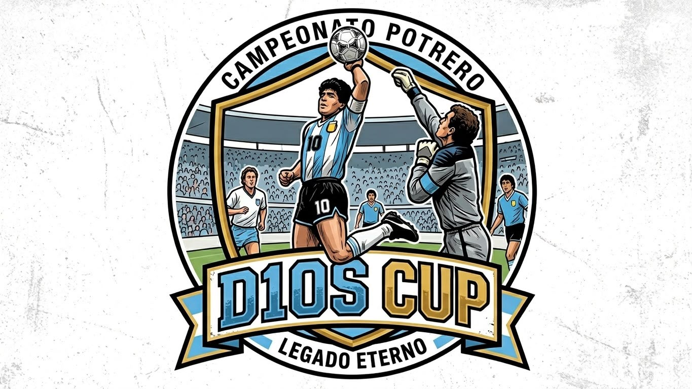

<p align="center">
  
</p>

# D10S Cup

**Plataforma de Organización Deportiva**

Proyecto del Taller de Construcción de Software — Año 2026.

|                 |                                                                       |
| --------------- | --------------------------------------------------------------------- |
| **Profesor**    | Alexis Martínez                                                       |
| **Integrantes** | Huechepan Santiago, Marteniuk Ignacio, Namuncura Joaquín, Enzo Patiño |

---

## Descripción

D10S Cup es una plataforma web para la gestión integral de torneos de fútbol. Permite organizar competencias, inscribir equipos, programar partidos, registrar resultados y ofrecer un módulo de ventas de entradas e indumentaria oficial para los aficionados.

El fútbol vuelve a su esencia: los mejores equipos se enfrentan por la gloria en el torneo más apasionante del año.

---

## Roles de usuario

El sistema contempla tres tipos de actores, definidos en el relevamiento del proyecto:

### Administrador

- Crear y gestionar torneos.
- Registrar, modificar y eliminar equipos; validar inscripciones.
- Programar partidos (fecha, horario y lugar) y cargar resultados.
- Gestionar la venta de entradas e indumentaria (productos, precios y stock).
- Administrar usuarios y acceder a reportes de partidos, ventas y participación.

### Equipos

- Registrarse e inscribirse en torneos disponibles.
- Consultar calendario de partidos, resultados y estadísticas.
- Gestionar datos del equipo e integrantes (logo, lista de buena fe).

### Aficionados

- Registrarse e iniciar sesión (requisito previo para comprar).
- Comprar entradas e indumentaria mediante carrito de compras.
- Consultar calendario, resultados e historial del torneo.
- Gestionar su perfil e historial de compras.

---

## Funcionalidades

### Implementadas (frontend)

| Módulo                 | Descripción                                                                       |
| ---------------------- | --------------------------------------------------------------------------------- |
| **Inicio**             | Landing page con hero, vista previa de productos y formulario de contacto.        |
| **Productos / Tienda** | Catálogo de entradas e indumentaria con filtros, sidebar de navegación y carrito. |
| **Torneos**            | Listado de torneos con búsqueda y filtros por modalidad (Fútbol 11, 8 y 5).       |
| **Partidos**           | Carrusel de próximos encuentros y calendario mensual del fixture.                 |
| **Resultados**         | Tablas de posiciones por grupo y llave eliminatoria (cuartos, semis y final).     |

### Planificadas (requieren backend)

- Registro y autenticación de usuarios (equipos y aficionados).
- Inscripción de equipos con carga de logo y plantel.
- Generación de tickets digitales (QR o ID único) vinculados al aficionado.
- Procesamiento de pagos e historial de compras.
- Carga de estadísticas detalladas por partido (goles, tarjetas, asistencias).
- Panel de administración y reportes.

---

## Requisitos no funcionales

- **Seguridad:** contraseñas hasheadas y datos de transacciones protegidos.
- **Persistencia:** base de datos relacional (MySQL) para el historial del torneo.
- **UI/UX:** interfaz intuitiva y responsive, optimizada para consulta desde móviles.
- **Rendimiento:** soporte de múltiples solicitudes simultáneas en días de partido o lanzamiento de entradas.

---

## Tecnologías

| Capa                        | Stack                                                                |
| --------------------------- | -------------------------------------------------------------------- |
| **Frontend**                | HTML5, CSS3, JavaScript (vanilla)                                    |
| **Iconos**                  | Font Awesome, Lucide Icons                                           |
| **Backend** _(planificado)_ | API REST + MySQL                                                     |
| **Diseño**                  | CSS custom properties, layout responsive, tipografías Outfit e Inter |

---

## Estructura del proyecto

```
D10S Cup/
├── index.html                  # Página de inicio (landing)
├── HTML/
│   ├── productos.html          # Tienda: entradas e indumentaria
│   ├── torneos.html            # Listado y gestión de torneos
│   ├── partidos.html           # Próximos partidos y fixture
│   └── Resultados.html         # Tablas de grupos y eliminatoria
├── CSS/
│   ├── style.css               # Estilos de la landing
│   ├── base.css                # Estilos compartidos (torneos, partidos)
│   ├── Productos.css           # Estilos de la tienda
│   ├── torneos.css
│   ├── partidos.css
│   └── resultados.css
├── JS/
│   ├── app.js                  # Lógica de la landing
│   ├── torneos.js              # Filtros y búsqueda de torneos
│   ├── partidos.js             # Calendario y carrusel de partidos
│   └── resultados.js           # Renderizado de tablas y bracket
├── assets/                     # Logos, camisetas, gorras, etc.
└── Proyecto D10S (1) (3) (1).pdf   # Documentación completa del proyecto
```

---

## Cómo ejecutar el proyecto

Al ser un sitio estático, no requiere instalación de dependencias.

**Opción 1 — Abrir directamente**

Abrir `index.html` en el navegador.

**Opción 2 — Servidor local (recomendado)**

```bash
# Con Python
python -m http.server 8000

# Con Node.js (npx)
npx serve .
```

Luego visitar `http://localhost:8000`.

## Deploy en Vercel

El proyecto se despliega como sitio estático multipágina, sin paso de compilación. Para conectarlo:

1. Importar el repositorio `EnzoPatino/D1os-Cup` en Vercel y mantener la rama `main`.
2. La configuración de Vercel publica la raíz del repositorio y conserva las rutas relativas existentes (`HTML/`, `CSS/`, `JS/`, `assets/`).
3. La URL y la clave publicable de Supabase ya están configuradas en `JS/supabaseClient.js`. La clave publicable puede exponerse en el navegador; nunca usar una `service_role`.
4. Hacer el deploy. Cada push a `main` generará un deploy de producción y los pull requests tendrán previews.
5. En Supabase, agregar el dominio de producción y los dominios Preview que se usarán a **Authentication → URL Configuration → Redirect URLs**. Definir como **Site URL** el dominio de producción. Esto permite que los enlaces de recuperación vuelvan a `HTML/restablecer.html`.

Para ejecutar localmente, correr `npm run dev` o `python3 -m http.server 8000` y visitar `http://localhost:8000`. No hace falta instalar dependencias.

---

## Mapa de navegación

```
Inicio (index.html)
├── Productos (HTML/productos.html)
│   ├── Torneos (HTML/torneos.html)
│   ├── Partidos (HTML/partidos.html)
│   ├── Resultados (HTML/Resultados.html)
│   ├── Entradas / Indumentaria (filtros en tienda)
│   └── Carrito de compras
└── Contacto (#contactos)
```

---

## Documentación

La documentación formal del proyecto — relevamiento, requisitos funcionales y no funcionales, casos de uso, diagramas de clases, entidad-relación, secuencia y mapas de navegación — se encuentra en:

[`Proyecto D10S (1) (3) (1).pdf`](<./Proyecto%20D10S%20(1)%20(3)%20(1).pdf>)

Los wireframes de las pantallas de Torneos y Partidos están en `booseto de Torneos y Partidos.png`.

---

## Licencia

Proyecto académico — Todos los derechos reservados © 2026 D10S Cup.
